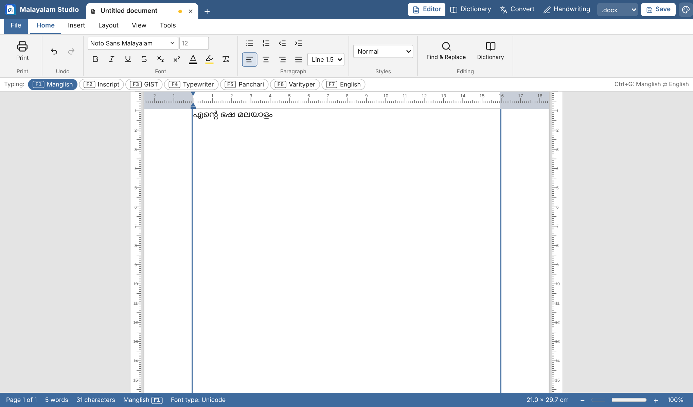
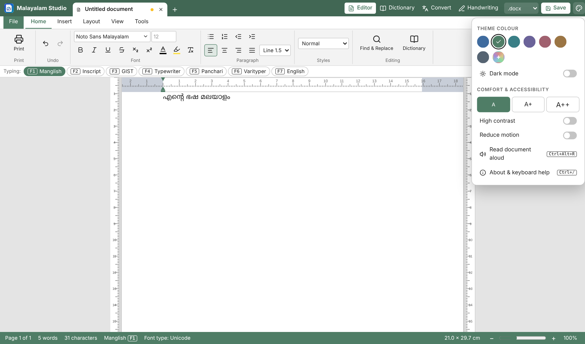
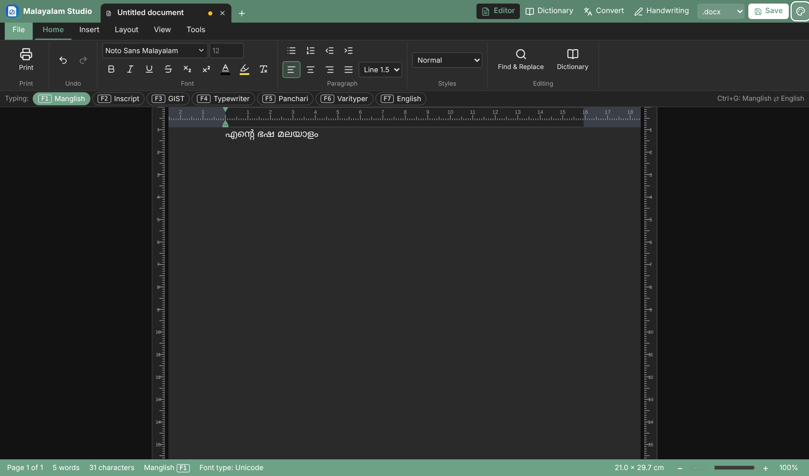

<div align="center">


# Malayalam Studio
### മലയാളം സ്റ്റുഡിയോ

**A Word-style Malayalam word processor — in your browser and on Windows.**
Type in Manglish, Inscript, GIST, Typewriter or Panchari · write with 13 open-licensed Malayalam fonts · save to DOCX, ODT, PDF, HTML & more.

[](https://devarajankp.github.io/mlstudio/)
[](https://github.com/Devarajankp/mlstudio/releases/latest)

[](https://github.com/Devarajankp/mlstudio/releases)
[](LICENSE)
[](https://github.com/Devarajankp/mlstudio/actions)




</div>

---

## ✨ Highlights

| | |
|---|---|
| 📝 **Word-like editor** | Ribbon, tabs (＋ / ×), rulers on all four sides, page view, zoom 25–300 %, find & replace, tables, pictures, text boxes, lines, headers/footers, page numbers. |
| ⌨️ **Seven typing methods** | Manglish (phonetic), Inscript, GIST, Typewriter, Panchari, Varityper, English — switch with **F1–F7**. Compact on-screen keyboard (**F8**). |
| 🔤 **Open-licensed Malayalam fonts** | Noto Sans/Serif Malayalam, Chilanka, Manjari, Gayathri, Meera, Rachana, Karumbi, Keraleeyam, Dyuthi, Anjali Old Lipi, Uroob, Anek Malayalam, Baloo Chettan 2 — all SIL OFL 1.1. Add your own fonts (even legacy ML-TT ones) from *File → My fonts*; they stay on your device. |
| 💾 **Save anywhere** | `.docx` `.odt` `.pdf` (tagged, AES-256 passwords) `.html` `.txt` and its own `.mlstudio`. Direct **Print**. |
| 🖼️ **Objects you can grab** | Resize, move and rotate pictures, text boxes, lines and tables; floating mini toolbar; picture transparency, brightness, contrast, blur, flip, shadow. |
| 🎨 **Eye-friendly themes** | 7 soft colours + your own, dark mode, interface size, high contrast, reduced motion. |
| ♿ **Accessible** | Screen-reader labels & announcements, skip link, full keyboard use, read-aloud (Ctrl+Alt+R). |
| 📚 **Dictionary & converters** | English ⇄ Malayalam dictionary (Olam data), Unicode ⇄ legacy converter, Handwriting Studio. |
| 🔒 **Private** | No accounts, no tracking. Your documents never leave your device. |

<div align="center">


</div>

## 🚀 Use it

**On the web (nothing to install)** → **https://devarajankp.github.io/mlstudio/**
Works offline after the first load. Chrome / Edge / Firefox / Safari.

**On Windows (type Malayalam in *any* program)** → download from [**Releases**](https://github.com/Devarajankp/mlstudio/releases/latest):

| File | What it is |
|---|---|
| `Malayalam-Studio-Setup-x.y.z.exe` | Installer (Start-menu + Desktop shortcut, per-user, no admin needed) |
| `Malayalam-Studio-Portable-x.y.z.exe` | Single portable file – run from a pen drive |

> Windows SmartScreen may say *"unknown publisher"* because the app is not code-signed yet → **More info → Run anyway**.

### Windows extras
* **Scroll Lock** = Malayalam typing ON/OFF anywhere (Word, Notepad, browser…); the keyboard light follows. **Pause/Break** = next layout.
* **Manglish pop-up** next to your cursor — type `namaskaram`, press **Space** → നമസ്കാരം. ↑↓ choose · 1-9 pick · Esc keeps English. Turn it off from the tray.
* Offers to **install the Malayalam fonts** your PC is missing (no admin needed).
* Your tabs and documents come back when you reopen the app.
* Compact tray menu, Settings window, on-screen ON/OFF message, minimise / maximise / close built into the header (close keeps typing alive in the tray).
* **Auto-update**: web changes are pulled in automatically; a new installer is announced from GitHub Releases.

## ⌨️ Shortcuts

| Key | Action | Key | Action |
|---|---|---|---|
| F1 – F7 | Typing method | Ctrl+S / Ctrl+Shift+S | Save / Save as |
| Ctrl+G | Manglish ⇄ English | Ctrl+P | Print |
| F8 | On-screen keyboard | Alt+T / Alt+W | New / close tab |
| F9 | Dictionary lookup | Ctrl + / − / 0 | Zoom |
| Ctrl+Alt+R | Read aloud | Ctrl+/ | Help & About |

## 🧑‍💻 Develop

```bash
git clone https://github.com/Devarajankp/mlstudio && cd mlstudio
npm install
npm run dev        # http://localhost:3000
npm run build      # type-check + production build (dist/)
npm test           # key-engine stress test
```

**Stack:** React 19 · Vite · Tailwind v4 · TipTap/ProseMirror · docx · pdf-lib · fontkit · qpdf-wasm · Electron + koffi (Windows hook).

```
src/            web app (editor, ribbon, export pipeline, dictionary…)
desktop/        Windows app (tray, keyboard hook, Manglish pop-up, settings)
public/         fonts, dictionary data, brand
.github/        CI, GitHub Pages deploy, Windows release workflow
```

### 🔖 Versions & releases
Semantic versioning. To publish a new version:

```bash
npm version minor          # 1.2.0 → 1.3.0 (+ git tag)
git push --follow-tags     # builds the installer and creates the GitHub Release
```
Pushing to `main` redeploys the website; installed Windows apps fetch the web changes on their own.
See [CHANGELOG.md](CHANGELOG.md).

## 🙏 Inspiration & acknowledgements

Malayalam Studio stands on the shoulders of a lot of generous work. *Inspired by* means ideas and public behaviour only — **no code or assets were copied** from these projects.

* **Mozhi / Varamozhi** and similar phonetic input tools — the idea of typing Malayalam with English letters.
* **Inscript** (Government of India / C-DAC), **GIST** and classic Malayalam typewriter layouts — public keyboard standards.
* **Microsoft Word** and **Edentext** — usability inspiration for a familiar ribbon / page-view workflow (the project does not use any code from them; Edentext is AGPL-3.0 and was deliberately **not** used).
* **Olam English–Malayalam dictionary** ([olam.in](https://olam.in/open/enml/), ODbL 1.0) and [kiranps/English-Malayalam-Dictionary](https://github.com/kiranps/English-Malayalam-Dictionary) (MIT).
* **Swathanthra Malayalam Computing (SMC)**, **Rachana Akshara Vedi / RIT** and the Malayalam typography community — Chilanka, Manjari, Gayathri, Meera, Rachana, Karumbi, Keraleeyam, Dyuthi, Anjali Old Lipi, Uroob fonts and years of open Malayalam tooling ([smc/font-installer](https://github.com/smc/font-installer), [rit-fonts](https://gitlab.com/rit-fonts)).
* **Ek Type** — Anek Malayalam and Baloo Chettan 2 fonts. **Google Noto** fonts. **Google Input Tools** (optional online suggestions).
* Open-source libraries: TipTap/ProseMirror, React, Vite, docx, mammoth, pdf-lib, fontkit, fflate, qpdf, wawoff2, Lucide, Electron, koffi — full list in [THIRD_PARTY_NOTICES.md](THIRD_PARTY_NOTICES.md).

## ⚖️ Licence, copyright & things to know

* Source code: **MIT** © 2026 Devarajan K P — see [LICENSE](LICENSE).
* Dictionary data is **ODbL 1.0** (attribution + share-alike); fonts keep their own licences (OFL for Noto/SMC fonts).
* Only **SIL OFL 1.1** fonts are bundled ([FONTS_LICENSE.txt](public/fonts/FONTS_LICENSE.txt)); proprietary legacy fonts are *not* included. Read **[LEGAL.md](LEGAL.md)** (risk checklist, privacy, trademarks, takedown steps).
* Not affiliated with Microsoft, Google, C-DAC, the Government of India or any font/dictionary publisher. All trademarks belong to their owners.
* Contributions are welcome: [CONTRIBUTING.md](CONTRIBUTING.md) · [Code of Conduct](CODE_OF_CONDUCT.md) · [Security](SECURITY.md).

<div align="center"><sub>Made with ❤️ in Ottapalam, Kerala · മലയാളത്തിനായി</sub></div>
